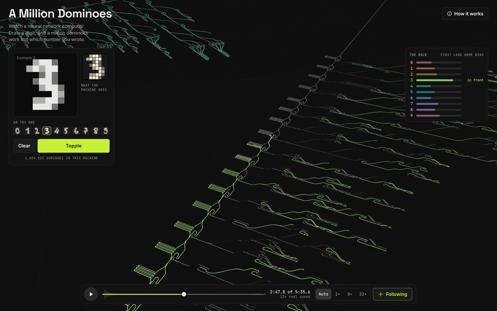

<h1 align="center">A Million Dominoes</h1>

<p align="center">
  Draw a digit. A million falling dominoes work out which number you wrote.
</p>

<p align="center">
  <a href="https://github.com/otomop/a-million-dominoes/actions/workflows/ci.yml"></a>
  <a href="LICENSE"></a>
  
</p>

<p align="center">
  <a href="docs/how-it-works.md">How it works</a> ·
  <a href="docs/evidence.md">Evidence</a> ·
  <a href="docs/design-notes.md">Design notes</a> ·
  <a href="docs/format.md">File format</a>
</p>

<p align="center">
  
  
</p>

> [!NOTE]
> **This project is AI-generated.** The code, tests and documentation were written by Claude (Anthropic) using [Claude Code](https://claude.com/claude-code), under human direction. The automated tests and the checks in [docs/evidence.md](docs/evidence.md) pass, but the code has not been independently reviewed.

## About

A Million Dominoes is a handwritten-digit classifier compiled into a field of 1,026,525 dominoes and simulated in the browser. The classifier is a neural network in which every unit is a single logic gate, so it can be laid out as lines, junctions and bridges of dominoes. Your drawing tips a set of starter dominoes, and the chain reaction ends with one of ten domino pictures toppling to show the answer.

## Highlights

- **A learned circuit, not a hand-built one.** A 7,500-gate network trained on handwritten digits reads 97% of digits from writers it never saw.
- **Compiled layout.** A compiler places every domino, sizes every gate for timing, and verifies that no two dominoes overlap.
- **Verified end to end.** The domino field gives the network's own answer on all 1,797 test digits.
- **Runs in the browser.** A run is computed in a fraction of a second; the whole field renders with WebGL2 and can be played, scrubbed and explored.
- **Small.** The compiled machine is a 1 MB download. No server, no framework.

## Quick start

Requires Node.js 22 or later and a browser with WebGL2.

```bash
git clone https://github.com/otomop/a-million-dominoes.git
cd a-million-dominoes/web
npm install
npm run dev
```

Open the printed address, draw a digit or pick an example, and press **Topple**.

| Control | Action |
|---|---|
| Drag | Orbit the camera |
| Scroll | Zoom |
| <kbd>Space</kbd> | Play or pause |
| <kbd>←</kbd> <kbd>→</kbd> | Step through the run |
| **How it works** | Guided walkthrough of each part of the machine |

## How it works

1. **Input.** The drawing is reduced to an 8×8 grid of ink levels, which gives 192 bits.
2. **Starters.** Each bit controls a group of starter dominoes. Those whose condition holds are tipped together; this is the machine's only input.
3. **Logic.** Signals travel as falling lines, two per bit. Merging lines form an OR, and a line knocked down from its far end blocks a later signal.
4. **Counting.** Each digit has a race lane that takes a detour for every gate that voted against it, so the digit with the most votes finishes first.
5. **Finish.** The first lane home closes the other nine lanes' gates and topples a picture of its digit.

See [docs/how-it-works.md](docs/how-it-works.md) for the full description.

## Verification

| Check | Result |
|---|---|
| Accuracy on writers not seen in training | 97.05% of 1,797 digits |
| Field output equals network output | 1,797 of 1,797 |
| Same, with ±10% random timing variation | 1,797 and 1,795 of 1,797 in two runs |
| Gadgets in rigid-body physics with placement noise | 99.75% to 100% per gadget type |
| Browser simulation against the Python reference | Identical on all reference runs |

Methods, full figures and limitations are in [docs/evidence.md](docs/evidence.md) and [docs/design-notes.md](docs/design-notes.md).

## Project structure

```
a-million-dominoes/
├── compiler/              Python: training, layout compiler, validation
│   ├── dominoes/          the compiler package
│   ├── physics/           rigid-body gadget tests (Rapier)
│   ├── tests/             end-to-end tests
│   └── models/            the trained network
├── web/                   TypeScript and WebGL2 page
│   ├── src/
│   └── public/            the compiled machine and example digits
└── docs/                  design, evidence, prior art, file format
```

## Development

**Page**

```bash
cd web
npm test          # unit tests and comparison with the Python reference
npm run build     # type-check and production build
```

**Compiler** (Python 3.11 or later)

```bash
cd compiler
python -m venv .venv
source .venv/bin/activate        # Windows: .venv\Scripts\activate
pip install numpy scipy numba pytest
pytest -q
```

To rebuild the machine file from the trained network (about five minutes):

```bash
python -m dominoes.build --net models/final.npz --out ../web/public --report ../docs/validation.json
```

Retraining the network requires the public datasets, which `dominoes/prepare_data.py` downloads.

## Documentation

- [How it works](docs/how-it-works.md): the network, the gadgets, the layout and the timing
- [Evidence](docs/evidence.md): what was tested, how, and the results
- [Design notes](docs/design-notes.md): design decisions, relation to neural networks, physical scale, limitations
- [Prior art](docs/prior-art.md): related projects and what differs here
- [File format](docs/format.md): the compiled machine file

## Acknowledgements

- Differentiable logic gate networks: Petersen, Borgelt, Kuehne and Deussen (2022). The implementation here is independent.
- Datasets: UCI Optical Recognition of Handwritten Digits and UCI Pen-Based Recognition of Handwritten Digits (CC BY 4.0); MNIST (CC BY-SA 3.0).
- Physics tests: [Rapier](https://rapier.rs) (Apache-2.0).

## License

[MIT](LICENSE)
