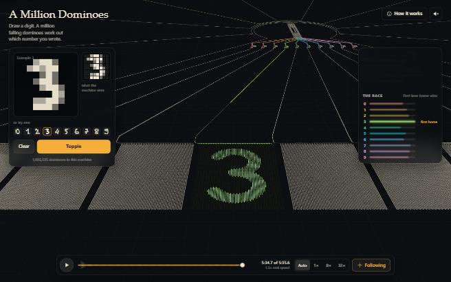

# A Million Dominoes

**Draw a digit. A million falling dominoes work out which number you wrote.**



A small neural network was trained so that every unit in it is a single logic gate. A compiler then laid that circuit out as 1,026,525 dominoes: lines for wires, joins for OR, head-on collisions for blocking, bridges for crossings. Your drawing tips some starter dominoes. After that, nothing happens except dominoes knocking over dominoes, until one of ten pictures topples and shows the answer.

It runs in a browser. Nothing is physically built.

## Try it

```
cd web
npm install
npm run dev
```

Open the address it prints, draw a digit (or pick an example), and press **Topple**. Drag to look around, scroll to zoom, scrub the timeline to run time backwards. **How it works** in the top corner is a nine-step walkthrough with a "Show me" button for each kind of part.

## How it works, in six lines

1. **The drawing becomes 192 yes-or-no answers.** It is shrunk to an 8×8 grid, and each square is asked three questions about how much ink it holds.
2. **Each answer tips starter dominoes.** There are 3,506 of them. Every one whose answer is true is tipped at the same instant. That is the only push the machine ever gets.
3. **Every fact travels on two lines**, one that falls if it is true and one that falls if it is false, because a line still standing could mean "no" or "not yet".
4. **Gates are small arrangements.** Two lines joining make OR. A line knocked down from its far end blocks whatever arrives later. Those two, with the two-line trick, build any logic.
5. **The count is a race.** Each digit has a lane that passes its 50 votes. Every "no" sends it round a six-second detour. The digit with the most "yes" votes gets home first.
6. **First home wins, and only one.** The first lane to arrive fires a common line that shuts the other nine lanes' gates. Its own claim slips through a quarter of a second ahead, and topples a picture of its digit.

The long version, with the layout and timing methods, is in [docs/how-it-works.md](docs/how-it-works.md).


## Why it is worth knowing

The dominoes are slow and enormous on purpose. They put a few things about today's AI out on a floor where you can see them.

- **A trained network is a fixed machine.** Nothing on the floor learns. The learning happened earlier, in software; what is left is a fixed layout that turns an input into an answer. Chatbots and image generators work the same way: a long training, then a frozen calculation run again for every word or picture.
- **The rules were learned, not written.** Nobody told the machine what a 7 looks like. A program showed it tens of thousands of labelled digits and nudged it slightly after each one. That nudging, gradient descent, is how every modern network is trained. A gate cannot be nudged, so during training each unit was a blend of all sixteen possible gates, and at the end each settled on its strongest.
- **It does not matter what it is made of.** The same 7,500 learned gates give the same answers as code, as a chip, or as dominoes. A chip's switches flip in under a billionth of a second; a domino takes about a thirtieth of a second. Speed is the reason AI runs on silicon.
- **Gates are the cheapest thing a computer can do.** Ordinary networks are built from multiplications, billions of them per word for a large chatbot, which is why AI needs so much hardware and power. Logic-gate networks are a real line of research into doing the same job far more cheaply; the paper that introduced them reports over a million digit images a second on one processor core.
- **It decides by weighing evidence, and it can be wrong.** Each digit collects votes and the most votes wins. The race shows how close it was. Every modern network works like this underneath, including the ones that sound certain.
- **You can see what a small skill costs.** Reading one digit takes a million dominoes and ten football pitches. The networks in the news are many millions of times larger.

## The machine in numbers

| | |
|---|---|
| Dominoes | 1,026,525 |
| Field | 283 m × 244 m |
| Starter dominoes | 3,506 |
| Blocking gates | 2,024 |
| OR merges | 1,628 |
| Bridges | 1,678 |
| Network | five layers of logic gates: 2,000, 2,000, 2,000, 1,000, 500 |
| One run at real domino speed | about six minutes to the picture |
| Download | 1.0 MB |

## What was checked

Full numbers and methods are in [docs/evidence.md](docs/evidence.md).

| Question | Result |
|---|---|
| Does the network read handwriting from people it never saw? | 97.05% of 1,797 scanned digits from 13 held-out writers. Weakest digit, 9: 93.3% |
| Does it read other kinds of drawing? | 96.1% on pen-tablet strokes; 93.8% on 5,000 MNIST test digits (both datasets' training parts were used in training) |
| Does the domino field give the network's answer? | 1,797 of 1,797, with exactly one picture falling each time |
| And with every domino's timing off by up to 10%? | 1,797 of 1,797 in one run; 1,795 in another, where two vote ties toppled two pictures |
| Do any dominoes overlap? | None |
| Does each kind of gadget work in rigid-body physics with sloppy placement? | Split, merge, bridge and vote section: no failures in 100 or more trials each. Blocking gate: 99.75% at its design timing |
| Does the browser run the same machine as the checks? | Yes: its simulation matches reference results domino for domino, and its drawing-to-grid step matches on 40 test drawings |

## What is not claimed

- **The whole field has never been run as rigid bodies.** Each kind of gadget has. The page runs an event model whose timings were measured on those gadgets.
- **Nobody has built it.** With millimetre placement errors about five of the 2,024 blocking gates would misfire per run, and one wrong gate can change the answer.
- **It is a time-lapse.** A real run takes about six minutes; the page says so and can play at true speed.
- **Nobody has tested it with strangers' finger drawings.** The accuracy figures are for three public datasets pushed through the same normalisation as the drawing pad.
- **The idea of an odd machine reading handwriting is not new**, and neither are domino logic gates. See [docs/prior-art.md](docs/prior-art.md) for what existed and what is different here.

## If you built it for real

- **A floor** 283 by 244 metres, about ten football pitches, smooth and level.
- **A million dominoes**, about eight tonnes of plastic at 8 grams each, and 1,678 small bridges.
- **Setting up:** at one domino every three seconds, about 860 hours. A crew of twenty would need more than five full days if nobody knocked one over.
- **The push:** 3,506 small pushers, one per starter domino, wired to 192 switches and fired together. This is the one part that is not dominoes.
- **Resetting:** about half the field falls in a run and has to be stood up again by hand.

The weight and pace are assumptions, stated so you can change them. The rest follows from the layout.

## Repository layout

| Path | What it is |
|---|---|
| `compiler/dominoes/` | Python: trains the network, compiles it to a placed field, checks it, writes the machine file |
| `compiler/physics/` | Rigid-body tests of the gadgets (Rapier, driven from Python) |
| `compiler/tests/` | End-to-end tests on a small random network |
| `compiler/models/final.npz` | The trained network |
| `web/` | The page: TypeScript, WebGL2, no framework |
| `web/public/machine.bin.gz` | The compiled machine the page loads ([format](docs/format.md)) |
| `docs/` | How it works, evidence, prior art, file format |

## Reproducing it

```
cd compiler
python -m venv ../.venv
../.venv/Scripts/pip install numpy scipy numba pytest      # bin/pip on macOS and Linux
../.venv/Scripts/python -m pytest -q                        # eleven tests, a few seconds
../.venv/Scripts/python -m dominoes.build --net models/final.npz --out ../web/public --report ../docs/validation.json
```

The build takes about five minutes: one for compiling and timing the field, the rest for checking all 1,797 test digits three times. Retraining the network needs the public datasets, which `dominoes/prepare_data.py` downloads; see that file for sources and licences.

```
cd web
npm test          # 83 tests, including the domino-for-domino comparison with the Python reference
npm run build
```

## Credits

- **Training method:** differentiable logic gate networks (Petersen, Borgelt, Kuehne and Deussen, 2022). The implementation here is independent.
- **Data:** UCI Optical Recognition of Handwritten Digits and UCI Pen-Based Recognition of Handwritten Digits (both CC BY 4.0), and MNIST (CC BY-SA 3.0).
- **Physics tests:** [Rapier](https://rapier.rs) (Apache-2.0).

## Licence

MIT. See [LICENSE](LICENSE).
